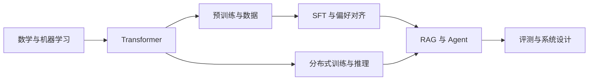

# LLM 算法工程师面试指南

系统整理大语言模型算法工程师需要掌握的核心知识、常见面试题与实践方法，帮助读者把概念讲清楚、把公式推出来、把工程取舍说具体。

面向具备 Python、线性代数和机器学习基础的求职者。内容覆盖模型训练、推理优化和应用算法；可根据目标岗位选择阅读顺序。

## 从这里开始

- [学习路线](docs/learning-roadmap.md)：按岗位选择重点，提供 4 周复习计划和面试前检查清单。
- [知识点导航](docs/knowledge-map.md)：逐项定位考点，查看参考仓库与本项目的分类对应。
- [72 道面试题索引](docs/question-bank.md)：按主题查找题目，直接跳转到参考回答与追问。
- [公式与易错点速查](docs/cheatsheet.md)：复习 Attention、LoRA、DPO、显存和检索指标。
- [项目准备与模拟面试](docs/interview-practice.md)：组织项目经历、设计消融实验，完成一轮模拟面试。
- [代码练习](examples/README.md)：用无第三方依赖的 Python 实现因果注意力和检索评测。
- [论文与官方资料](docs/references.md)：按主题回到原始论文和官方文档核对细节。

## 知识地图

| 模块 | 核心内容 | 面试应达到的程度 |
| --- | --- | --- |
| [01 数学与机器学习基础](docs/01-fundamentals.md) | Softmax、交叉熵、归一化、优化器、分词 | 能推导损失梯度，解释数值稳定性 |
| [02 Transformer 与模型结构](docs/02-transformer.md) | Attention、RoPE、GQA、MoE、多模态 | 能写出张量形状并比较结构取舍 |
| [03 预训练与数据](docs/03-pretraining.md) | 训练目标、数据治理、Scaling Law、长上下文 | 能设计数据流程并排查训练异常 |
| [04 SFT 与参数高效微调](docs/04-finetuning.md) | 标签掩码、LoRA、QLoRA、实验设计 | 能说明微调目标、显存来源和退化原因 |
| [05 偏好对齐与推理能力](docs/05-alignment.md) | RLHF、PPO、DPO、GRPO、蒸馏 | 能比较目标函数、数据需求和训练成本 |
| [06 分布式训练](docs/06-distributed-training.md) | 显存估算、并行策略、ZeRO、性能分析 | 能按瓶颈选择方案并解释通信代价 |
| [07 推理优化与部署](docs/07-inference.md) | KV Cache、FlashAttention、量化、调度 | 能估算容量并分析延迟与吞吐 |
| [08 RAG 与 Agent](docs/08-rag-and-agents.md) | 检索、重排、故障定位、工具调用 | 能搭建评测闭环并处理权限边界 |
| [09 评测与可靠性](docs/09-evaluation.md) | 检索指标、生成评测、污染、A/B 实验 | 能定义成功标准并判断改进是否可信 |
| [10 系统设计与场景题](docs/10-system-design.md) | 企业知识库、微调、容量规划、故障处理 | 能围绕约束给出可验证的完整方案 |
| [11 经典 NLP、Embedding 与模型比较](docs/11-nlp-and-embeddings.md) | Word2Vec、BERT、对比学习、模型选型 | 能连接传统 NLP 与现代检索、生成模型 |
| [12 提示词与上下文工程](docs/12-prompt-and-context.md) | Few-shot、CoT、记忆、工具协议、工作流 | 能组织上下文并验证应用链路 |



## 如何使用

每章包含核心知识、6 道问答、常见误区和原始资料。P0 是建议优先掌握的核心考点，P1 是进一步展开的专题；该标记并非面试出现频率统计。

1. 先独立回答题目，再阅读参考要点。每题练习 1 分钟概括、3 分钟展开。
2. 遇到公式时写出变量、形状和假设；涉及效果提升时补上基线、数据划分和评测口径。
3. 运行代码练习，修改输入验证边界，再把一个真实项目按模板整理成可追问的案例。

示例运行环境为 **Python 3.8+**，无需 GPU、模型权重或外部服务。所有命令均在仓库根目录执行：

```bash
python3 examples/attention.py
python3 examples/retrieval_metrics.py
python3 -m unittest discover -s tests -v
python3 tools/check_docs.py
```

## 内容约定与贡献

知识分类参考了 [wdndev/llm_interview_note](https://github.com/wdndev/llm_interview_note)、[km1994/LLMs_interview_notes](https://github.com/km1994/LLMs_interview_notes) 和 [Datawhale llm-universe](https://github.com/datawhalechina/llm-universe)。具体采用方式与来源记录见 [参考项目对照](docs/reference-projects.md)。本项目按知识点独立整理答案和练习，题目未标注为未经核实的公司真题。

参考回答是解释思路，不是唯一标准答案。数值估算会写明精度、架构和单位；训练超参数需要通过具体任务验证。内容中的性能数据若无特别注明均不构成实测结果，项目模板中的空项需要填写真实实验。

欢迎通过 Issue 或 Pull Request 补充题目、修正推导和分享可复现案例。提交方式与格式见 [贡献指南](CONTRIBUTING.md)。原始论文的历史结论与工具当前能力应分别核对；资料整理日期为 **2026-10-25**。
